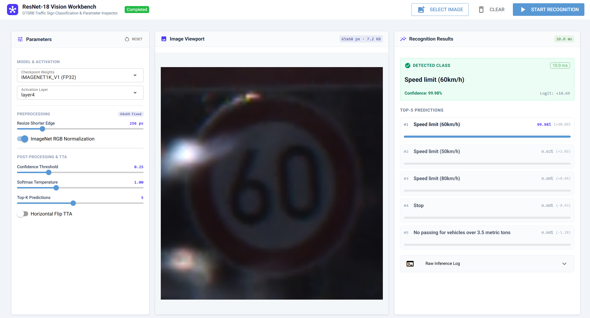

### Directory / File Descriptions

| Item      | Description |
|-----------|-------------|
| `gpu/`    | Checks whether a CUDA-capable GPU is available locally, and handles device setup (CPU/GPU). |
| `model/`  | Stores model files such as trained weights and checkpoints. |
| `dmg/`    | Displays images from the dataset for inspection and visualization. |
| `app.py`  | Graphical user interface (GUI) that makes it easy to test the model interactively. |
| `main.py` | Main script used for training the ResNet18 model on the German traffic sign dataset. |

---

## Model

- **Architecture:** ResNet18
- **Framework:** PyTorch
- **Training environment:** CUDA

## Dataset

- **Name:** German Traffic Sign Recognition Benchmark (GTSRB)
- **Task:** Multi-class traffic sign classification

---

## Usage

### 1. Check GPU Availability

Run the script in `gpu/` to verify whether CUDA is available on your machine.

### 2. Preview Dataset Images

Use the scripts in `dmg/` to display sample images from the dataset and information about dataset.

### 3. Train the Model

```bash
python main.py
```

### 4. Evaluate the model on the test set
```bash
python test.py
```
### 5. Model inference
Manual model inference
```bash
# Interactive manual input of image path
python infer.py
# Direct parameter passing for inference of a single image
python infer.py gtsrb/Test/00000.png --top-k 5 --threshold 0.3
```
Based on GUI
```bash
python app.py
```
Before test install GUI

    pip install nicegui

Destination address

    http://localhost:8080





